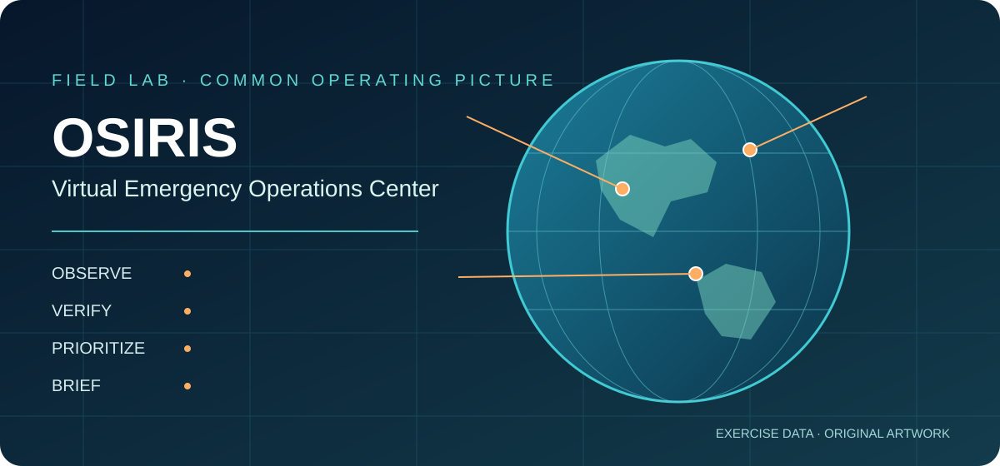

# OSIRIS · Virtual Emergency Operations Center Field Lab



**Explore public signals. Verify evidence. Build a common operating picture. Brief with uncertainty.** Ten executable JupyterLite notebooks, a Jupyter Book, and interactive 2D/3D exercise views introduce [OSIRIS](https://github.com/simplifaisoul/osiris) as a possible component of a Virtual Emergency Operations Center (VEOC).

**[JupyterLite Lab](https://jltobias.github.io/JupyterLite-Osiris/lab/index.html) · [Jupyter Book](https://jltobias.github.io/JupyterLite-Osiris/book/) · [2D operations map](https://jltobias.github.io/JupyterLite-Osiris/scenes/operations-2d.html) · [3D scene](https://jltobias.github.io/JupyterLite-Osiris/scenes/operations-3d.html) · [OSIRIS live map and cockpit](https://osirisai.live/)**

> The GitHub Pages links above are intended deployment URLs and become live after the repository's Pages workflow succeeds and GitHub Pages is enabled with **GitHub Actions** as its source. The separate [OSIRIS live console](https://osirisai.live/) is operated upstream. All sectors, events, facilities, routes, and measurements in this field lab are **fictional exercise data**. This project is an independent educational companion, not an official OSIRIS product or a production EOC.

## Explore

| Experience | What it does |
|---|---|
| [Start notebook 00](https://jltobias.github.io/JupyterLite-Osiris/lab/index.html?path=00_start_here.ipynb) | Set up the observe → verify → prioritize → brief workflow. |
| [Jupyter Book](https://jltobias.github.io/JupyterLite-Osiris/book/) | Read the guided mission, methods, caveats, and source desk. |
| [2D operations map](https://jltobias.github.io/JupyterLite-Osiris/scenes/operations-2d.html) | Compare fictional calls, flood depths, and reporting; inspect sectors and export GeoJSON. |
| [3D scene](https://jltobias.github.io/JupyterLite-Osiris/scenes/operations-3d.html) | Rotate a thematic globe and inspect columns that encode fictional assistance calls. |
| [OSIRIS live console](https://osirisai.live/) | Explore the upstream live application, layers, cockpit, cameras, and broadcasts. |
| [NOAA satellite scenes](https://www.star.nesdis.noaa.gov/GOES/) · [NASA Worldview](https://worldview.earthdata.nasa.gov/) | Open external imagery in its provider context, including product dates and attribution. |
| [Notebook 09: full cockpit](https://jltobias.github.io/JupyterLite-Osiris/lab/index.html?path=09_cockpit_and_beyond.ipynb) | Review OI, RECON, cyber, sanctions, broadcasts, and other functions beyond the VEOC core. |

### Notebook missions

| Notebook | Field task |
|---|---|
| [00 · Start here](content/00_start_here.ipynb) | Establish the common operating picture. |
| [01 · Layer atlas](content/01_osiris_layer_atlas.ipynb) | Select relevant OSIRIS layers and source checks. |
| [02 · 2D picture](content/02_2d_common_picture.ipynb) | Map demand, depth, and reporting. |
| [03 · 3D scene](content/03_3d_terrain_scene.ipynb) | Explain thematic column height and visual distortion. |
| [04 · Hazards](content/04_hazards_and_feeds.ipynb) | Track event and retrieval times. |
| [05 · Logistics](content/05_aviation_maritime_logistics.ipynb) | Test travel-time assumptions. |
| [06 · Cameras](content/06_cameras_and_verification.ipynb) | Build a verification log. |
| [07 · Health access](content/07_health_and_access.ipynb) | Compare counts, rates, beds, and reporting. |
| [08 · Sitrep](content/08_priorities_and_sitrep.ipynb) | Review weights and produce a dated situation report. |
| [09 · Full cockpit](content/09_cockpit_and_beyond.ipynb) | Tour advanced OSIRIS capabilities and scope boundaries. |

Open a notebook in JupyterLite, select **Python (Pyodide)**, then **Run → Run All Cells**. Each notebook is independent and uses bundled exercise data. The browser downloads the runtime and Python packages on first use. Browser files may be cached; export your work before clearing site data. Static Pages cannot proxy OSIRIS API routes or store private keys.

## How this relates to OSIRIS

[OSIRIS](https://github.com/simplifaisoul/osiris) is a separate Next.js and MapLibre-based open-source intelligence dashboard. Its README documents aviation, public cameras, seismic events, fire hotspots, severe weather, news, solar weather, satellite and cyber context, plus OI Assist/Forecast and RECON features. Some layers are live feeds; some are static reference data. Availability and API credentials vary by source and deployment. This repository provides reproducible teaching exercises and outward links; it does **not** bundle, fork, proxy, or endorse the upstream application. See its [README](https://github.com/simplifaisoul/osiris#readme), [license](https://github.com/simplifaisoul/osiris/blob/master/LICENSE), and [deployment guide](https://github.com/simplifaisoul/osiris/blob/master/DOCKER.md).

The experience draws design ideas from the author's [WorldView field lab](https://github.com/jltobias/JupyterLite-WorldView), [God's Eye View satellite lab](https://github.com/jltobias/JupyterLite-Gods-Eye-View-Satellite), [World Monitor prototype](https://github.com/jltobias/JupyterLite-World-Monitor-Prototype), and [STAC Browser](https://github.com/jltobias/JupyterLite-STAC-Browser). No code or artwork from those repos is copied here.

## Sources, attribution, and licensing

| Source / project | Use here and required care |
|---|---|
| [OSIRIS by simplifaisoul](https://github.com/simplifaisoul/osiris) | Concept and feature reference, externally linked. Upstream code is [MIT licensed](https://github.com/simplifaisoul/osiris/blob/master/LICENSE); preserve its copyright and license if you copy upstream code. This repo contains no upstream code. |
| [USGS Earthquake Hazards Program](https://earthquake.usgs.gov/fdsnws/event/1/) | Earthquake provider reference. If using live USGS data, cite USGS, record event/retrieval time, and follow [USGS policies and attribution](https://www.usgs.gov/information-policies-and-instructions/copyrights-and-credits). |
| [NASA EONET](https://eonet.gsfc.nasa.gov/docs/v3) and [NASA FIRMS](https://firms.modaps.eosdis.nasa.gov/) | Severe-event and fire provider references. Review each product's [NASA data use guidance](https://www.earthdata.nasa.gov/engage/open-data-services-and-software/data-and-information-policy), citation, and any underlying provider terms before publishing derived work. |
| [NOAA NHC](https://www.nhc.noaa.gov/) and [NOAA GOES imagery](https://www.star.nesdis.noaa.gov/GOES/) | Official forecast and satellite links. Preserve product timestamps and credits; consult [NOAA data policy](https://www.noaa.gov/information-technology/open-data-dissemination). |
| [OpenSky Network](https://opensky-network.org/) | Aviation provider reference. Flight data access, rate limits, and reuse terms are governed by [OpenSky's terms](https://opensky-network.org/about/terms-of-use); a marker does not establish mission or status. |
| [GDACS](https://www.gdacs.org/) | Disaster alert reference; inspect [GDACS terms and disclaimers](https://www.gdacs.org/About/overview.aspx) and verify local impact independently. |
| [OpenStreetMap](https://www.openstreetmap.org/copyright) | Road-network context is mentioned, but no OSM tiles or data are bundled in this version. If adding OSM data, provide the required © OpenStreetMap contributors attribution and comply with ODbL. |
| [WorldPop](https://www.worldpop.org/) | Population data is discussed, not bundled. Check the selected product's license, vintage, method, citation, and uncertainty. |
| [JupyterLite](https://jupyterlite.readthedocs.io/) · [Jupyter Book](https://jupyterbook.org/) · [Pyodide](https://pyodide.org/) · [NumPy](https://numpy.org/) · [Matplotlib](https://matplotlib.org/) | Tools used to build/run the lab. Their respective licenses apply to the software; this repository does not redistribute the upstream packages. |

**Repository content:** All notebooks, HTML viewers, workflow diagrams, and the SVG splash were authored for this repository. They are released under [MIT](LICENSE), including their source files. Names, links, and citations to external projects do not transfer ownership or license of those projects. External videos, cameras, satellite imagery, basemaps, and live feeds remain under their operators' terms; none are embedded or redistributed here. Check provider terms before recording, caching, or republishing media. The exercise data is invented and may be reused under this repo's MIT license.

## Build and deploy

The [Pages workflow](.github/workflows/pages.yml) regenerates notebooks, builds JupyterLite at `/lab/`, builds Jupyter Book at `/book/`, and publishes the two HTML scenes at `/scenes/`. Set **Settings → Pages → Source → GitHub Actions** in the destination repository. A successful run produces the links above.

For a local build with Python 3.11 or 3.12:

```bash
python -m pip install -r requirements-build.txt
python scripts/build_content.py
python scripts/execute_content.py
jupyter lite build --contents content --output-dir _site/lab
jupyter-book build content
```

Copy `content/_build/html/` into `_site/book/`, `scenes/` into `_site/scenes/`, and the splash assets into `_site/assets/` for a local static preview. The Pages workflow performs those copies. Jupyter Book executes no code at build time; its source notebooks are runnable in JupyterLite.

## Operational boundary

This field lab does not send alerts, authenticate sources, maintain an incident log service, or guarantee live availability. The weighted priority score is a transparent teaching heuristic. For actual response, use official warnings, local incident command, authorized communications, and verified field reports.
